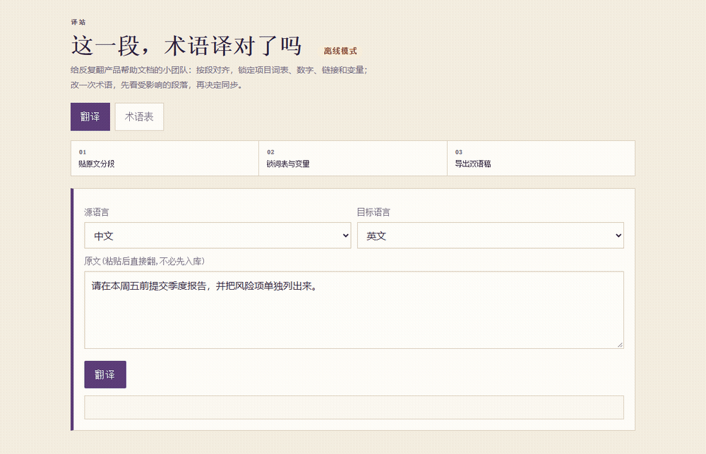
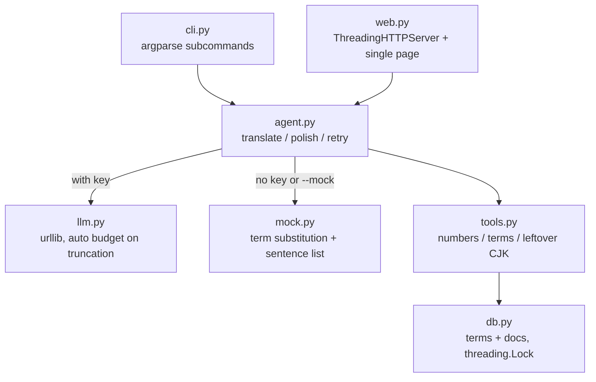

# yizhan (Translation Station)

[](https://github.com/wushiyi105-jpg/yizhan/actions)
[]()
[](./LICENSE)
[](https://codecov.io/gh/wushiyi105-jpg/yizhan)



Paste text or import a file, translate between Chinese, English, Japanese and more, with a glossary that keeps one term to one translation.

Two things burned me while translating product docs: numbers quietly changed (1,200 becoming 1200 or 12,00 depends on luck), and one term translated three different ways across the same document. yizhan makes both hard checks — **numbers and glossary terms are verified locally before anyone talks about fluency**.

## Features

- **Multi-language**: Chinese / English / Japanese / Korean / French / German, source and target both selectable.
- **Glossary**: after `terms add`, every translation gets the glossary in its system prompt and each entry is checked afterwards — the source says 待办清单, the output must contain `to-do list`.
- **Hard number checks**: a lost number fails the run; **month/day numbers are exempt** — "3 月" becoming March is not a lost number, otherwise the model is pushed into writing "the 3rd month", which is worse.
- **Automatic retry**: a failed check sends the problem list back to the model for one more pass; after two failures the previous version is kept and the problems are listed, no fake success.
- **Translation polish**: wording only; terms and numbers stay under the same checks.
- **Offline mode**: glossary substitution and tidy-up only, explicitly labelled "full-sentence translation needs a model" — rule-based literal translation is worse than none.
- **Two entry points**: CLI for batches, web page for quick pastes.

## Quick start

```bash
git clone https://github.com/wushiyi105-jpg/yizhan.git
cd yizhan
python -m yizhan terms add 待办清单 "to-do list"
python -m yizhan add doc.txt --src zh --dst en
python -m yizhan translate 1
```

No key means offline mode. To connect a model:

```bash
cp .env.example .env
# fill LLM_API_KEY; defaults to https://api.deepseek.com + deepseek-flash
```

```bash
LLM_BASE_URL=https://open.bigmodel.cn/api/paas/v4 LLM_MODEL=glm-4.6 python -m yizhan translate 1
```

Web:

```bash
python -m yizhan web --port 8767
# http://127.0.0.1:8767
```

Run in Docker (the container uses the default port 8000):

```bash
docker build -t yizhan .
docker run -p 8000:8000 yizhan
```

## Command reference

| Command | What it does |
| --- | --- |
| `add <file> [--src zh] [--dst en]` | Import source text; `-` reads stdin |
| `docs` | Document list |
| `show <doc>` | Source and translation overview |
| `translate <doc>` | Translate and store |
| `polish <doc>` | Polish an existing translation |
| `terms add <zh> <en> [--note]` | Add a term |
| `terms list` | List terms |
| `terms rm --id <n>` | Delete a term |
| `stats` / `web` | Stats / web UI |

Global switches `--mock`, `--json`, `--model`, `--base-url`, `--api-key`, `--db` work before or after the subcommand.

## 🤔 Why not just ask a general LLM

A general model translates more smoothly than most tools. Yizhan adds the three things it cannot:

1. **Numbers and terms are not lost** — after translation, the output is checked locally: are the numbers, dates and model numbers all present, and are glossary terms translated as agreed? A miss sends it back for another pass, at most twice. The classic chat-model error is turning "3 working days" into "several days" with no visible sign.
2. **The glossary decides** — how a term is translated in your industry comes from the local glossary, applied in both directions, so one manual never ends up with three names for the same part.
3. **Documents and glossary stay local** — source, translation and glossary sit on this machine, so contracts and product docs are not uploaded; a model call sends only the current passage.
4. **Offline covers part of it** — with no key it applies glossary substitutions and splits long sentences into pending segments, stating clearly that this version is not a finished translation.

## 🎯 Use cases

- **Product docs both ways**: manuals and help-centre articles with the glossary fixed first, then numbers and model numbers checked so "charge for 2 hours" never becomes "charge for a while".
- **Bilingual contracts**: one wrong number or date is expensive; the glossary pins down "force majeure" and "penalty".
- **Paper abstracts**: one abstract in several languages with consistent terminology, so reviewers do not trip over shifting names.

## 🗺 Roadmap

- **Translation memory**: reuse the previous translation when a sentence repeats, keeping the document consistent.
- **Glossary conflict detection**: fail early when a term has two translations, instead of discovering it after the fact.
- **Bilingual export**: source and translation paragraph by paragraph for proofreading.
- **Glossary import/export**: CSV so a team can share one list.
- **Segment complexity hints**: after splitting, flag sentences whose structure warrants a human read.

## ❓ FAQ

**Where do I get an API key?**
The project ships without one. It talks to DeepSeek (`https://api.deepseek.com`) by default — set `LLM_API_KEY`. Any OpenAI-compatible endpoint works.

**Where is data stored, and is it uploaded?**
Source, translation and glossary are in local SQLite; a model call sends the current passage plus relevant glossary terms, not the whole document.

**Does it work without a key?**
It applies glossary substitutions and splits sentences, but produces no finished translation, and says so rather than passing off a half-product.

**How do I switch models?**
Change `LLM_BASE_URL`, `LLM_MODEL` and `LLM_API_KEY`, or override with `--model`.

**Why was my translation sent back?**
A number or a glossary term did not match. The number of retries and the failing item are in the output, so you see which check failed rather than a bare "failed".

## How it works



Three decisions:

1. **Number checks exempt dates.** `tools.date_numbers` pulls out month/day figures like 「3 月」「15 日」 and drops them from the must-match set; the year still has to survive. The first version had no exemption and the model produced "the 3rd month of 2026" just to keep the digit — uglier than a lost number.
2. **Glossary checks run both ways.** ZH→EN verifies the Chinese term appeared and its English form was used; EN→ZH does the reverse. An empty glossary reports "cannot verify consistency" instead of a fake pass.
3. **Two retries, then stop.** A failed check feeds the problems back for a rewrite; two failures ends it, with the translation and the problems handed over. More attempts only burns tokens.

`llm.py` also handles truncated output: on `finish_reason=length` it doubles the token budget and retries, instead of parsing half a JSON object. Learned that one on a long translation.

## Layout

```
yizhan/
├── yizhan/
│   ├── __init__.py / __main__.py
│   ├── llm.py     # OpenAI-compatible client + .env loader + truncation retry
│   ├── db.py      # terms + docs (thread-safe)
│   ├── tools.py   # numbers / CJK / terms / sentences
│   ├── mock.py    # offline glossary draft
│   ├── agent.py   # translate & polish + hard checks + retry
│   ├── cli.py     # command line
│   └── web.py     # web UI
├── data/doc-sample.json
├── tests/test_yizhan.py
├── assets/demo.gif
├── .github/workflows/test.yml
├── pyproject.toml
├── README.md / README.en.md
└── CHANGELOG.md / SECURITY.md / CODE_OF_CONDUCT.md / CONTRIBUTING.md
```

## Author

Luo Zhizhi · 15071889700

MIT License, Copyright (c) 2026 wushiyi105-jpg
