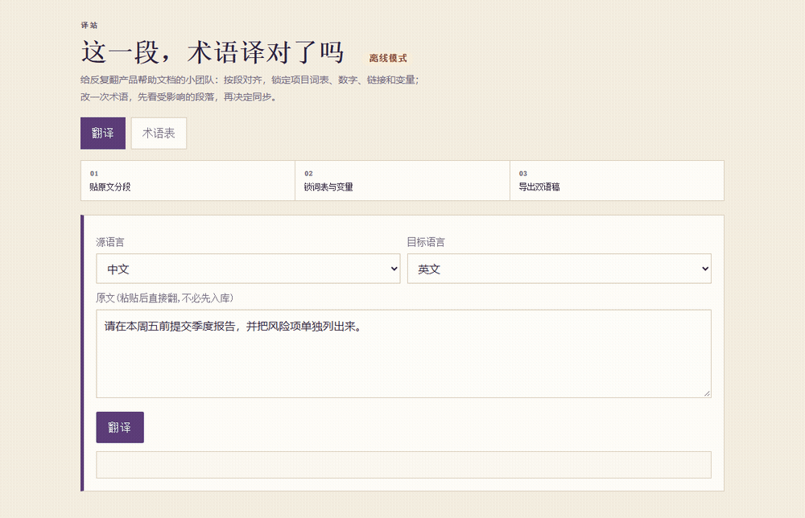
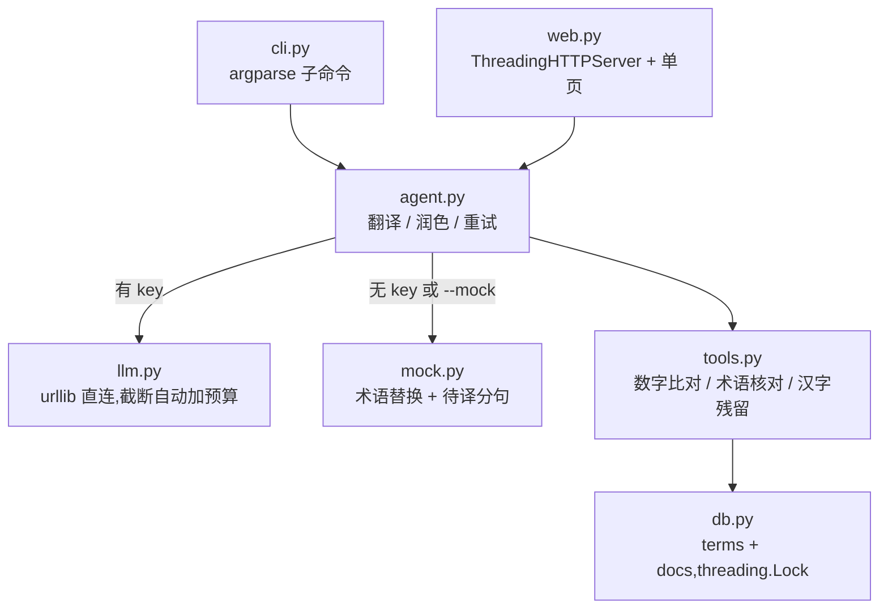

# 译站 yizhan

[](https://github.com/wushiyi105-jpg/yizhan/actions)
[]()
[](./LICENSE)
[](https://codecov.io/gh/wushiyi105-jpg/yizhan)



粘贴文本或导入文件,中英日多语言互译,术语表管住"同一个词只能有一种译法"。

我做产品文档翻译时被两件事坑过:数字被悄悄改掉(1,200 变成 1200 还是 12,00 全靠运气),以及同一个术语在全文里译出三种说法。译站把这两件事都做成硬校验——**译文回来后,先在本地比数字、比术语,再谈通顺**。

## 功能特性

- **多语言互译**:中 / 英 / 日 / 韩 / 法 / 德,源语言目标语言都能指定。
- **术语表**:`terms add` 之后,每次翻译都会把术语表塞进系统提示,并在译后逐条核对——原文出现了「待办清单」,译文里就必须有 `to-do list`。
- **数字硬校验**:丢数字直接判不通过;**但年月日豁免**——「3 月」写成 March 不算丢数字,否则模型会被逼着写 "the 3rd month" 这种怪句子。
- **不合格自动重试**:校验不过会把问题清单回灌给模型再译一遍,两次不过就保留上一版,把问题列给你,不假装成功。
- **译文润色**:只改表达,术语与数字仍受同一套校验约束。
- **离线模式**:只做术语替换与排版清理,并明确标注"整句翻译需要模型"——规则引擎硬译出来的东西比不译更糟。
- **双入口**:CLI 批处理,网页粘贴即译。

## 快速开始

```bash
git clone https://github.com/wushiyi105-jpg/yizhan.git
cd yizhan
python -m yizhan terms add 待办清单 "to-do list"
python -m yizhan add doc.txt --src zh --dst en
python -m yizhan translate 1
```

不配 key 自动进离线模式;接模型:

```bash
cp .env.example .env
# 填 LLM_API_KEY,默认 https://api.deepseek.com + deepseek-flash
```

```bash
LLM_BASE_URL=https://open.bigmodel.cn/api/paas/v4 LLM_MODEL=glm-4.6 python -m yizhan translate 1
```

网页:

```bash
python -m yizhan web --port 8767
# http://127.0.0.1:8767
```

## 命令参考

| 命令 | 作用 |
| --- | --- |
| `add <file> [--src zh] [--dst en]` | 导入原文,`-` 从 stdin 读 |
| `docs` | 译稿列表 |
| `show <稿>` | 原文与译文概况 |
| `translate <稿>` | 翻译并入库 |
| `polish <稿>` | 润色已有译文 |
| `terms add <中文> <英文> [--note]` | 加术语 |
| `terms list` | 术语表 |
| `terms rm --id <n>` | 删术语 |
| `stats` / `web` | 统计 / Web UI |

全局开关 `--mock`、`--json`、`--model`、`--base-url`、`--api-key`、`--db`,放在子命令前后都认。

## 工作原理



三处取舍:

1. **数字比对带日期豁免**。`tools.date_numbers` 找出「3 月」「15 日」这类月日数字,从必查集合里剔除;年份仍然必查。第一版没做这个豁免,模型为了保住数字被逼出 "the 3rd month of 2026",比丢数字还难看。
2. **术语是双向核对**。中译英查中文术语是否出现、对应英文是否给出;英译中反过来查。术语表为空时明确提示"无法校验一致性",不留假通过。
3. **重试两次就停**。硬校验失败会把问题回灌并要求重写;两次还不过就停手,把译文和问题一起交出来——继续硬试只会烧 token。

另外 `llm.py` 处理了输出被 `max_tokens` 截断的情况:看到 `finish_reason=length` 就把预算翻倍重试,避免把半截 JSON 当结果解析。这个坑在长译文上踩过一次,记忆深刻。

## 目录结构

```
yizhan/
├── yizhan/
│   ├── __init__.py / __main__.py
│   ├── llm.py     # OpenAI 兼容客户端 + .env 加载 + 截断重试
│   ├── db.py      # terms + docs(线程安全)
│   ├── tools.py   # 数字/汉字/术语/分句
│   ├── mock.py    # 离线术语对齐草稿
│   ├── agent.py   # 翻译与润色 + 硬校验 + 重试
│   ├── cli.py     # 命令行
│   └── web.py     # Web UI
├── data/doc-sample.json
├── tests/test_yizhan.py
├── assets/demo.gif
├── .github/workflows/test.yml
├── pyproject.toml
├── README.md / README.en.md
└── CHANGELOG.md / SECURITY.md / CODE_OF_CONDUCT.md / CONTRIBUTING.md
```

## 作者

shiyi · GitHub [@wushiyi105-jpg](https://github.com/wushiyi105-jpg) · wushiyi105@gmail.com

MIT License,Copyright (c) 2026 wushiyi105-jpg
